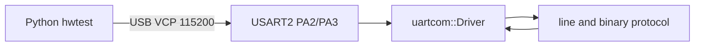

# uartcom

Register-level USART driver and console firmware for the **NUCLEO-F446RE** (STM32F446RET6). The UART path does not call the STM32 HAL. Clocks, GPIO, and the NVIC are programmed the same way, by writing the peripheral registers directly.

The board's ST-Link USB port is the whole lab setup. USART2 is wired to the ST-Link virtual COM port, and a Python 3 script on the computer drives the firmware.

## Hardware

| Item | Value |
| --- | --- |
| Board | NUCLEO-F446RE |
| MCU | STM32F446RET6, Cortex-M4F, 180 MHz, 512 KiB flash, 128 KiB SRAM |
| Link | USART2, PA2 TX / PA3 RX, alternate function 7 |
| Host port | ST-Link VCP, 115200 8N1 (`/dev/cu.usbmodem*`) |
| LED | LD2 on PA5, on after init, toggles once per reply, blinks fast on a fault |

This tree was brought up on the Nucleo attached to this machine (ST-Link id `0x10006421`, 512 KiB flash). `make identify` reads that id again.

Details: [docs/hardware.md](docs/hardware.md).

## Quick start

Requirements: `make`, Python 3.9+, OpenOCD, and an `arm-none-eabi-g++` that ships with the C++ library. Homebrew's GCC 16 bottle is built without headers, so the Makefile falls back to a full toolchain when it can find one (see [C++ standard](#c-standard)).

```sh
make              # host unit tests, regression tests, and the firmware ELF
make flash        # program build/uartcom.elf through the onboard ST-Link
make hwtest       # Python suite against the live board
make check-target # flash, then hwtest
```

`make flash` replaces whatever image is currently on the MCU.

After reset the firmware prints:

```text
UARTCOM STM32F446RE USART2 ready
```

A terminal at 115200 8N1 can type `PING`, `HELP`, or `ECHO hello`. The Python driver is `tools/hwtest.py`. Set `UARTCOM_PORT` if the VCP is not the only `/dev/cu.usbmodem*` device.

## Layout

```text
include/uartcom/     baud math, frame encoding, ring, driver, protocol
firmware/            startup, 180 MHz clock, GPIO, USART2 application
tests/               host unit tests and register-level regression tests
tools/hwtest.py      Python 3 driver that runs on the computer
docs/                driver, protocol, hardware, and test notes
```



The driver is a template over a register adapter. On the MCU that adapter is `board::MmioUsart`, which does volatile loads and stores. Host tests pass a `FakeUsart` with the same methods, so the interrupt service routine is exercised without the chip.

## What the firmware does

On reset the startup code copies `.data`, zeroes `.bss`, turns on the FPU, and runs `SystemInit` before static constructors. `SystemInit` raises SYSCLK to 180 MHz:

1. HSE in bypass mode (the ST-Link 8 MHz MCO). If that clock is absent, HSE crystal mode, then HSI.
2. PLL to 180 MHz, APB1 divided by 4 (45 MHz, this is the USART2 kernel clock), APB2 divided by 2 (90 MHz).
3. Voltage scale 1 and over-drive, which the F446 requires at 180 MHz. Flash wait states are set to 5 before the switch.

If the PLL or over-drive does not lock, SYSCLK stays on the 16 MHz HSI and the baud generator is programmed for that clock instead. `INFO` reports which path was taken.

USART2 is then reset through `RCC_APB1RSTR` and programmed for 8N1 at 115200. The application answers the command protocol in [docs/protocol.md](docs/protocol.md).

## Driver

Public types live in `include/uartcom/`. The pieces that matter:

- `compute_baud()` writes the USART_BRR value with integer half-up rounding. No floating point.
- `encode_frame()` maps data bits and parity onto CR1 `M`, `PCE`, and `PS`.
- `Driver` owns TX and RX rings. `write()` / `read()` are called from thread context. `service()` is called from the USART IRQ, or polled when interrupts are left off.
- `Protocol` parses ASCII commands and a CRC-32 binary frame. It never touches a register, which is why the same code runs in the host regression tests.

At 45 MHz and 115200 baud the generator programs `BRR = 391` (oversampling by 16). The actual rate is 115089 baud, which is −959 ppm. The Python suite recomputes that number from the `INFO` line and requires an exact match.

Register programming order, the baud formula, and the IRQ rules are in [docs/uart-driver.md](docs/uart-driver.md).

## Tests

| Target | Where it runs | What it locks |
| --- | --- | --- |
| `make test-unit` | Host, ASan + UBSan | Baud table, ring wrap, IRQ TX/RX, protocol commands |
| `make test-regression` | Host, ASan + UBSan | Frozen CR1/CR2/CR3/BRR images, 100-byte loopback across an 8-byte ring, scripted transcript |
| `make hwtest` | This computer, against the board | Banner, `INFO` clock and C++ standard, echo, hex, CRC-32, binary frames, counters |

`make test` runs the two host binaries and the Python baud-math checks. It does not need the board. [docs/testing.md](docs/testing.md) describes each layer.

## Continuous integration

GitHub Actions runs on every push and pull request. The host job runs `make test`. The firmware job installs the xPack Arm GCC 14.2.1 toolchain and runs `make firmware`. `make hwtest` stays on a machine that has the Nucleo attached.

## C++ standard

The Makefile asks the host compiler and the Arm compiler for C++23, then C++20, then C++17, and compiles with the newest one that is accepted. Both compilers on this machine take C++23 (`__cplusplus == 202302`). The firmware `INFO` line reports that value, and `hwtest` compares it with `build/firmware_cxx.txt`.

Language features that need a newer standard are wrapped in `#if __cplusplus`, so a fallback standard still builds. On C++23 the baud divider uses `if consteval`, and frame encoding uses `std::to_underlying`.

Homebrew `arm-none-eabi-gcc` 16.2.0 is configured `--without-headers`, so it cannot compile `<cstdint>` even though it accepts `-std=c++23`. `tools/find-arm-cxx.sh` skips that compiler and uses the first `arm-none-eabi-g++` that has a C++ library. Override it with `make ARM_CXX_REQUEST=/path/to/arm-none-eabi-g++`.

## Troubleshooting

- **No banner.** Close any serial monitor, then `make check-target`. The VCP has to be free while OpenOCD resets the MCU. `INFO` will say `pll=0` and `sysclk=16000000` if the PLL path failed; the link should still answer at 115200.
- **Flash verify failed.** Confirm `make identify` prints `0x10006421` and `512 KiB`. This image is linked for the F446RE.
- **`make firmware` cannot find `<cstdint>`.** Install a full Arm GCC (the xPack release works) or pass `ARM_CXX_REQUEST`.
- **LD2 blinks rapidly.** The firmware took a fault. The usual cause during bring-up was a bad clock or a broken startup copy; `INFO` not appearing plus a blinking LED means the fault handler is running.
